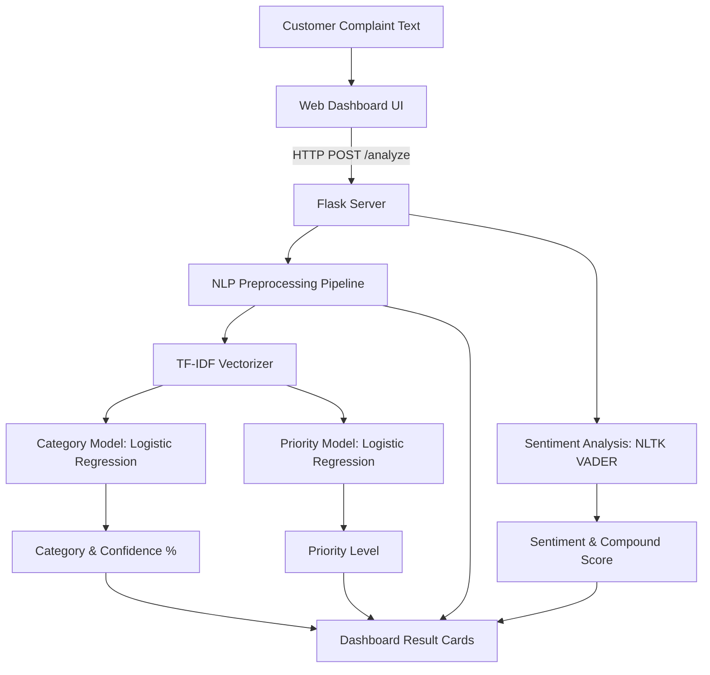

# NLP-Based Automated Customer Complaint Classification and Priority Detection System

An AI-powered Natural Language Processing (NLP) and Machine Learning mini-project developed for **BE Computer Engineering / IT (Semester 7)**. The system automatically categorizes customer complaints, detects urgency priority levels, extracts sentiment polarity scores, and presents actionable insights through a clean, modern web dashboard.

---

## 1. Project Title
**NLP-Based Automated Customer Complaint Classification and Priority Detection System**

---

## 2. Abstract
In modern digital commerce and customer service operations, businesses receive high volumes of unstructured complaints across diverse communication channels. Manually reading, categorizing, and prioritizing each complaint leads to severe ticket backlogs, slow resolution of critical emergencies, and customer dissatisfaction. 

This project implements an end-to-end, interpretable NLP and Machine Learning solution. Customer complaint text is processed through a multi-stage NLP pipeline (tokenization, stop-word removal, and lemmatization), converted to numerical feature vectors using **TF-IDF (Term Frequency-Inverse Document Frequency)**, and classified into 6 domain categories using **Logistic Regression**. Concurrently, an ML priority classifier identifies urgency (**High**, **Medium**, **Low**), and **NLTK VADER** computes sentiment polarity and compound scores. The system is served via a lightweight **Flask** web application with a responsive dashboard.

---

## 3. Problem Statement
Support organizations face the following challenges:
1. **Manual Sorting Latency:** Reading and assigning incoming complaints manually takes excessive human effort.
2. **Delayed Emergency Response:** Critical issues (e.g., account takeover, unauthorized billing deductions, server outages) get delayed behind trivial inquiries.
3. **Subjective Human Triage:** Human agents triage tickets inconsistently based on varying personal interpretations.
4. **Lack of Sentiment Visibility:** Organizations lack instant visibility into customer frustration and emotional severity.

---

## 4. Objectives
- Automatically preprocess noisy, raw customer complaints using standard NLP algorithms.
- Classify complaints into 6 distinct categories with probabilistic confidence estimation.
- Detect ticket urgency priority (**HIGH**, **MEDIUM**, **LOW**) to ensure high-risk issues are surfaced first.
- Quantify emotional polarity using NLTK VADER sentiment analysis.
- Provide a responsive, beginner-friendly web interface with one-click presentation demo samples.
- Keep the technical architecture simple, fully explainable, and runnable on any student laptop without paid APIs or cloud dependencies.

---

## 5. Features
- **Complaint Input & One-Click Demos:** Interactive text box with 6 pre-configured sample complaints for presentation demos.
- **NLP Preprocessing Pipeline:** Visible display of cleaned, lemmatized tokens fed into the ML vectorizer.
- **Multi-Class Category Classification:** Predicts across 6 core customer service domains.
- **Urgency Priority Detection:** Evaluates urgency into High, Medium, or Low with color-coded badges.
- **VADER Sentiment Analysis:** Computes Compound, Negative, Neutral, and Positive valence metrics.
- **Authentic ML Confidence Scores:** Derived directly from logistic regression `predict_proba()`.
- **Robust Input Validation:** Rejects empty or sub-sentence queries without crashing.

---

## 6. Technologies Used
- **Frontend:** HTML5, CSS3 (Modern Flexbox/Grid dark dashboard), Vanilla JavaScript (ES6 `fetch` API)
- **Backend:** Python 3.10+ / 3.12+ / 3.14, Flask
- **NLP Libraries:** NLTK (Tokenization, WordNet Lemmatizer, Stopwords, VADER Lexicon)
- **Machine Learning:** Scikit-learn (TF-IDF Vectorizer, Logistic Regression, Train/Test Split, Metrics)
- **Data & Serialization:** Pandas, NumPy, Joblib

---

## 7. NLP Techniques
1. **Case Normalization:** Converts complaint text to lowercase to ensure uniform token matching.
2. **Regex Cleaning:** Strips URLs, email addresses, digits, and punctuation while preserving semantic structure.
3. **Word Tokenization:** Segments continuous character streams into individual lexical tokens via `nltk.word_tokenize`.
4. **Domain-Sensitive Stop-Word Filtering:** Filters non-informative English stop words while preserving critical service terms (e.g., `down`, `not`, `no`, `never`, `cannot`).
5. **Lemmatization:** Reduces morphological inflections to base dictionary lemmas using WordNet (e.g., *deducted* → *deduct*, *crashes* → *crash*).
6. **Sentiment Valence Scoring:** Evaluates lexical sentiment polarity using the rule-based VADER algorithm.

---

## 8. Machine Learning Algorithm: Logistic Regression
- **Algorithm:** Multinomial Logistic Regression (`sklearn.linear_model.LogisticRegression`).
- **Feature Representation:** TF-IDF with unigrams and bigrams (`ngram_range=(1, 2)`), sublinear term-frequency scaling (`sublinear_tf=True`), and up to 3000 max features.
- **Why Logistic Regression?**
  1. Fast training and lightweight inference footprint (ideal for student laptops).
  2. High interpretability via learned feature weights.
  3. Native calibrated class probabilities via softmax activation (`predict_proba`).
  4. Highly effective on sparse high-dimensional text matrices.

---

## 9. System Architecture

```
                  +---------------------------+
                  |     Customer / User       |
                  +-------------+-------------+
                                |
                                v
                  +---------------------------+
                  |  Web Interface (HTML/CSS) |
                  +-------------+-------------+
                                | (HTTP POST /analyze)
                                v
                  +---------------------------+
                  |       Flask Backend       |
                  +-------------+-------------+
                                |
                                v
                  +---------------------------+
                  |  NLP Text Preprocessing   |
                  | (Lower, Clean, Tokenize,  |
                  |   Stopwords, Lemmatize)   |
                  +-------------+-------------+
                                |
                                v
                  +---------------------------+
                  | TF-IDF Feature Extraction |
                  |    (Unigrams + Bigrams)   |
                  +-------------+-------------+
                                |
            +-------------------+-------------------+
            |                                       |
            v                                       v
+-----------------------+               +-----------------------+
|  Category Classifier  |               |  Priority Classifier  |
| (Logistic Regression) |               | (Logistic Regression) |
+-----------+-----------+               +-----------+-----------+
            |                                       |
            +-------------------+-------------------+
                                |
                                | (Parallel)
                                v
                  +---------------------------+
                  |     Sentiment Analysis    |
                  |        (NLTK VADER)       |
                  +-------------+-------------+
                                |
                                v
                  +---------------------------+
                  |    JSON Response Packet   |
                  +-------------+-------------+
                                |
                                v
                  +---------------------------+
                  | Responsive Dashboard View |
                  +---------------------------+
```

### Mermaid Architecture Diagram



---

## 10. Project Structure

```
customer_complaint_nlp/
│
├── app.py                      # Main Flask application and REST API endpoints
├── test_app.py                 # Automated end-to-end integration test suite
├── requirements.txt            # Python dependencies
├── README.md                   # Complete project documentation and guide
│
├── dataset/
│   ├── complaints.csv          # 330 balanced customer complaints dataset
│   └── generate_dataset.py     # Script to generate/reproduce the dataset
│
├── models/
│   ├── category_model.pkl      # Trained Logistic Regression for category classification
│   ├── priority_model.pkl      # Trained Logistic Regression for priority detection
│   └── tfidf_vectorizer.pkl    # Serialized TF-IDF feature extractor
│
├── nlp/
│   ├── __init__.py
│   ├── preprocessing.py        # Text cleaning, tokenization, stop-words, lemmatization
│   └── sentiment.py            # NLTK VADER sentiment analyzer
│
├── training/
│   ├── __init__.py
│   └── train_model.py          # Model training, train/test split, evaluation & serialization
│
├── templates/
│   └── index.html              # Modern, responsive web frontend dashboard
│
└── static/
    ├── style.css               # Clean dark-mode stylesheet with badges and animations
    └── script.js               # Client-side validation, asynchronous fetch & UI rendering
```

---

## 11. Dataset Description
The dataset (`dataset/complaints.csv`) contains **330 balanced records** across 6 customer complaint categories:

| Category | Sample Count | Sample Keywords / Topics |
| :--- | :--- | :--- |
| **Payment Issue** | 55 | Deducted twice, refund delayed, unauthorized charge, card declined, gateway timeout |
| **Delivery Issue** | 55 | Package not arrived, courier delayed, wrong address, lost in transit, doorstep drop |
| **Product Issue** | 55 | Damaged item, broken screen, fake product, missing parts, defective button |
| **Technical Issue** | 55 | App crashes, server error 500, unable to login, freeze on startup, unresponsive |
| **Account Issue** | 55 | Account hacked, reset password, OTP not received, locked account, email change |
| **Service Issue** | 55 | Abusive executive, call disconnected, technician no-show, ticket ignored, poor care |

Each record also has an assigned priority label (**High**, **Medium**, or **Low**).

---

## 12. Installation Instructions

### Windows (PowerShell or Command Prompt)
```powershell
# 1. Clone or navigate to the project directory
cd c:\Users\HP1\Desktop\customer_complaint_nlp

# 2. Create a virtual environment
python -m venv .venv

# 3. Activate the virtual environment
.\.venv\Scripts\activate

# 4. Install dependencies
pip install -r requirements.txt
```

### macOS / Linux
```bash
# 1. Navigate to directory
cd customer_complaint_nlp

# 2. Create virtual environment
python3 -m venv .venv

# 3. Activate virtual environment
source .venv/bin/activate

# 4. Install dependencies
pip install -r requirements.txt
```

---

## 13. How to Train the Model
To reproduce or retrain the models from the dataset:
```powershell
# Make sure your virtual environment is active
python training/train_model.py
```
This script will:
1. Load `dataset/complaints.csv`
2. Run the NLP preprocessing pipeline
3. Split into 80% Train / 20% Test sets (`random_state=42`)
4. Fit the TF-IDF vectorizer
5. Train both Logistic Regression classifiers
6. Output precision, recall, f1-score, and confusion matrices
7. Save serialized `.pkl` files into `models/`

---

## 14. How to Run the Web Application
```powershell
# Start the Flask web server
python app.py
```
Open your web browser and navigate to:
```
http://127.0.0.1:5000/
```

To run the automated verification test suite:
```powershell
python test_app.py
```

---

## 15. API Documentation

### 1. `GET /`
- **Description:** Renders the main dashboard interface.
- **Response:** HTML web page.

### 2. `POST /analyze`
- **Description:** Accepts raw complaint text and returns categorization, priority, sentiment, and NLP tokens.
- **Request Headers:** `Content-Type: application/json`
- **Request Body:**
```json
{
  "complaint": "My payment was deducted twice but my order was cancelled."
}
```
- **Success Response (200 OK):**
```json
{
  "category": "Payment Issue",
  "confidence": 0.579,
  "priority": "High",
  "priority_confidence": 0.762,
  "sentiment": "Negative",
  "compound_score": -0.7,
  "preprocessed_text": "payment deduct twice order cancel",
  "sentiment_details": {
    "compound_score": -0.7,
    "negative_score": 0.35,
    "neutral_score": 0.65,
    "positive_score": 0.0,
    "sentiment": "Negative"
  }
}
```
- **Error Response (400 Bad Request):**
```json
{
  "error": "Please enter a complaint before analyzing."
}
```

---

## 16. Example Demonstration Scenarios

| Test Complaint | Expected Category | Expected Priority | Expected Sentiment |
| :--- | :--- | :--- | :--- |
| *"My payment was deducted twice but my order was cancelled."* | **Payment Issue** | **High** | **Negative** |
| *"My package has not arrived for five days."* | **Delivery Issue** | **Medium** | **Neutral / Negative** |
| *"The application crashes whenever I try to login."* | **Technical Issue** | **High** | **Negative** |
| *"The product I received is damaged."* | **Product Issue** | **Medium** | **Negative** |
| *"My account was hacked and personal information changed."* | **Account Issue** | **High** | **Negative** |
| *"I want to know how I can change my account password."* | **Account Issue** | **Low** | **Positive / Neutral** |

---

## 17. Advantages
1. **Lightweight & Fast:** Runs in milliseconds without GPU hardware or external API latency.
2. **Deterministic & Explainable:** Logistic Regression weights and TF-IDF scores can be mathematically audited.
3. **Dual Model Strategy:** Separate classifiers for Category and Priority allow independent evaluation and tuning.
4. **Zero API Cost:** Completely free from cloud or subscription charges.
5. **No Hallucination:** Unlike Generative AI / LLMs, classification outputs are strictly bounded to target business taxonomy.

---

## 18. Limitations
1. **Dataset Size:** Built on a 330-sample educational dataset; enterprise deployment requires thousands of historical company tickets.
2. **Polysemy & Out-of-Vocabulary (OOV):** TF-IDF cannot capture deep semantic analogies across unseen slang or misspellings.
3. **Single Language Support:** Currently optimized for English complaints.
4. **Single-Label Assignment:** Multi-issue complaints (e.g., "delivery delayed AND wrong item") are mapped to the single dominant class.

---

## 19. Future Scope
1. **Multi-Label Classification:** Enable tickets to belong to multiple categories simultaneously.
2. **Contextual Word Embeddings:** Incorporate domain-fine-tuned BERT / RoBERTa models for enhanced semantics.
3. **Automated Ticketing Integration:** Direct connectors to Jira, Zendesk, or Freshdesk webhooks.
4. **Multilingual NLP:** Support regional languages using multilingual tokenizers.

---

## 20. Conclusion
The **NLP-Based Automated Customer Complaint Classification and Priority Detection System** demonstrates a practical application of Natural Language Processing and Machine Learning. By uniting text cleaning, lemmatization, TF-IDF vectorization, Logistic Regression, and VADER sentiment analysis under a clean Flask architecture, this project delivers an efficient, maintainable, and viva-ready solution for customer support automation.
